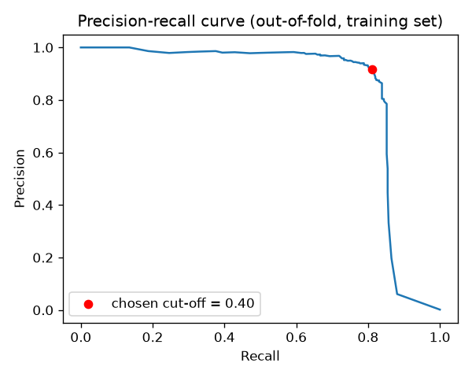

# Failure Prediction Pipeline

A reusable, config-driven machine learning pipeline for predicting **rare failures in imbalanced tabular data**.
The same code runs on two very different datasets. Switching datasets means writing a YAML config, not changing code.

| Dataset | Rows | Features | Failure rate | Final model | Test result |
|---|---|---|---|---|---|
| Credit Card Fraud (Kaggle) | 284,807 | 30 | 0.17% | Random forest, tuned cut-off | 72 / 95 frauds caught, 3 false alarms (PR-AUC 0.79) |
| SECOM semiconductor fab (UCI) | 1,567 | 590 sensors | 6.6% | Class-weighted logistic regression, 30 sensors | PR-AUC 0.17 on future runs (random ≈ 0.054) |

## Key findings
- **Accuracy is useless for rare failures:** predicting "no fraud" for everything scores 99.83% accuracy and catches nothing.
  Models are judged by recall, precision, F1 and PR-AUC.
- **Class weighting and SMOTE don't make a model better, they move its threshold:** recall rose from 0.61 to 0.91,
  but PR-AUC stayed at 0.75. Tuning the cut-off directly on out-of-fold predictions gave more control.
- **A random split overstated SECOM performance:** shuffled cross-validation estimated PR-AUC 0.23, but the model scored 0.076
  on later production runs, which points to process drift. Switching to time-aware CV, in-pipeline sensor cleaning and selection
  (590 → 30 sensors) and a simpler model raised performance on future runs to 0.17 (≈3× random).
- **Same pipeline, six breakages:** moving from credit card to SECOM exposed six hidden assumptions (data format, text columns,
  missing values, silent zero predictions, per-dataset model choice, overfitting). Each is documented in the log below.
- **Most predictive SECOM sensors:** sensor_59, 103, 431, 510, 430. sensor_59 ranked first in both EDA and feature selection.

## Pipeline design
```
CSV ──► SQLite ──► EDA ──► clean + impute + select ──► model ──► threshold tuning ──► one-time test
       (ingest)  (explore)    (inside the pipeline)              (out-of-fold CV)
```
- **No leakage:** cleaning, imputation, feature selection, scaling and SMOTE all live inside scikit-learn/imblearn
  pipelines, so they are re-fit on training folds only.
- **Test set used once:** models and cut-offs are chosen with cross-validation; the held-out test set is evaluated at the end.
- **Time-aware when needed:** if the config has a `time_column`, the data is split by time (train on the past,
  test on the future) and CV uses `TimeSeriesSplit`.

## Project structure
```
configs/            one YAML file per dataset (paths, target, split, cleaning, model)
scripts/            convert_secom.py: one-off converter for SECOM's raw files
src/
  config.py         load + validate configs
  ingest.py         CSV → SQLite
  explore.py        EDA: duplicates, missing values, feature separation plots
  prepare.py        duplicates, X/y, random or time-based split, CV choice
  cleaning.py       SensorCleaner: drops empty, constant and highly correlated columns
  models.py         candidate model pipelines
  evaluate.py       metrics
  train_baseline.py / compare_models.py / final_evaluation.py   pipeline steps
main.py             runs the whole pipeline from one config
reports/            generated metrics, plots and selected features per dataset
```

## Setup
```bash
python -m venv venv
venv\Scripts\activate          # Windows  (macOS/Linux: source venv/bin/activate)
pip install -r requirements.txt
```

## Data
Datasets are not stored in this repo.

### Credit Card Fraud
1. Download from Kaggle: "Credit Card Fraud Detection" (mlg-ulb)
2. Place the file at `data/raw/creditcard.csv`

### SECOM (semiconductor manufacturing)
1. Download from the UCI Machine Learning Repository ("SECOM")
2. Place `secom.data` and `secom_labels.data` in `data/raw/`
3. Convert to one CSV: `python scripts/convert_secom.py`

## How to run
```bash
python main.py --config configs/creditcard.yaml
python main.py --config configs/secom.yaml
```
Or only some steps (they always run in order):
```bash
python main.py --config configs/secom.yaml --steps compare final
```
Steps: `ingest` (CSV → SQLite), `explore` (EDA), `baseline`, `compare` (cross-validated model comparison),
`final` (threshold tuning + one-time test evaluation). Each step can also be run alone,
e.g. `python -m src.compare_models configs/secom.yaml`.

## Limitations
- SECOM's test set has only 17 failures, so its metrics are noisy (each failure ≈ 6% recall).
- SECOM sensors are anonymised, so selected sensors can't be interpreted physically.
- With `TimeSeriesSplit`, the earliest block of training data is never used for validation.
- The SECOM cut-off is a business decision (cost of a missed defect vs an extra inspection);
  both the default and the max-F1 cut-off are reported.
- HistGradientBoosting underperformed on credit card data; the cause wasn't found.

## Results

### Credit Card Fraud: baseline
Test set: 56,746 transactions, 95 frauds (stratified 80/20 split, after removing duplicates)

| Model | Accuracy | Precision | Recall | F1 | PR-AUC |
|---|---|---|---|---|---|
| Always predict "normal" | 0.9983 | 0.00 | 0.00 | 0.00 | 0.0017 |
| Logistic regression (scaled) | 0.9991 | 0.85 | 0.58 | 0.69 | 0.69 |

### Credit Card Fraud: model comparison (5-fold stratified CV on the training set)

| Model | Recall | Precision | F1 | PR-AUC |
|---|---|---|---|---|
| Logistic regression | 0.61 ± 0.06 | 0.86 ± 0.03 | 0.71 | 0.75 |
| Logistic regression, class_weight="balanced" | 0.92 ± 0.03 | 0.06 ± 0.01 | 0.11 | 0.75 |
| Logistic regression + SMOTE | 0.91 ± 0.03 | 0.06 ± 0.01 | 0.10 | 0.75 |
| Random forest | 0.78 ± 0.07 | 0.94 ± 0.02 | 0.85 | 0.83 |
| HistGradientBoosting (defaults) | 0.55 ± 0.14 | 0.47 ± 0.07 | 0.50 | 0.49 |

### Credit Card Fraud: final model (random forest, evaluated once on the test set)
Cut-off chosen by maximising F1 on out-of-fold training predictions (CV: precision 0.92, recall 0.81 at 0.40).

| Cut-off | Precision | Recall | F1 | PR-AUC | Caught | False alarms |
|---|---|---|---|---|---|---|
| 0.50 (default) | 0.97 | 0.73 | 0.83 | 0.79 | 69 / 95 | 2 |
| 0.40 (tuned) | 0.96 | 0.76 | 0.85 | 0.79 | 72 / 95 | 3 |



### SECOM: first pass (random split, no cleaning or feature selection)
1,567 production runs, 590 sensors, 104 failures (6.6%). Test set: 314 runs, 21 failures.

| Model | Cut-off | Precision | Recall | F1 | PR-AUC | Caught | False alarms |
|---|---|---|---|---|---|---|---|
| Gradient boosting | 0.5 (default) | 0.00 | 0.00 | 0.00 | 0.17 | 0 / 21 | 0 |
| Gradient boosting | 0.002 (tuned on CV) | 0.29 | 0.38 | 0.33 | 0.17 | 8 / 21 | 20 |

### SECOM: final (cleaning + top-30 sensor selection + time-aware CV)
Time-based split: trained on the earliest 1,254 runs (87 failures), tested on the latest 313 (17 failures).
Model chosen by time-aware CV PR-AUC: logistic regression with class weighting (CV PR-AUC 0.12; all models 0.10–0.12).

| Cut-off | Precision | Recall | PR-AUC | Caught | False alarms |
|---|---|---|---|---|---|
| 0.50 | 0.09 | 0.41 | 0.17 | 7 / 17 | 67 |
| 0.745 (max F1 on CV) | 0.25 | 0.12 | 0.17 | 2 / 17 | 6 |

Random-guess PR-AUC on this test set ≈ 0.054. Full sensor ranking: `reports/secom/selected_features.csv`.

## Log: what broke / what changed

### Credit Card: exploration
- 284,807 rows, 31 columns, 0 missing values; fraud rate 0.17% (492 rows).
- 1,081 exact duplicate rows → dropped before splitting, so the same row can't appear in both train and test (leakage).
- Strongest separating features: V17, V14, V12, V10 (frauds take strongly negative values).
  Every feature still overlaps with the normal range, so a multi-feature model is needed rather than threshold rules.

### Credit Card: baseline
- Added a "dumb" baseline (always predict normal) to show why accuracy can't be the metric.
- Scaling is done inside a scikit-learn Pipeline so it's fit on training data only (no test leakage).
- Only 95 frauds in the test set → each fraud ≈ 1% recall; single-split results are noisy.

### Credit Card: model comparison
- Switched to 5-fold stratified cross-validation on the training set; the test set is held back for one final evaluation.
- Class weighting and SMOTE raised recall from 0.61 to ~0.91 but precision fell to ~0.06 (≈15 false alarms per fraud).
  PR-AUC stayed at 0.75 for all three: they moved the decision threshold rather than improving the model.
- SMOTE runs inside an imblearn Pipeline so synthetic samples are created from training folds only (no leakage).
- Random forest was best (PR-AUC 0.83, F1 0.85) → selected for threshold tuning.
- HistGradientBoosting underperformed with high variance (PR-AUC 0.49). Disabling early stopping made it worse (0.35),
  so early stopping wasn't the cause. Not investigated further; a possible next step is a lower learning rate.

### Credit Card: threshold tuning + final test
- Cut-off chosen from out-of-fold probabilities on the training set, never from the test set.
- Selection rule (max F1) fixed before looking at test results.
- Tuned cut-off 0.40 caught 3 more frauds than the default 0.5 for 1 extra false alarm.
- Test recall (0.76) slightly below CV recall (0.81), within the CV spread (±0.07) → CV estimate was reliable.

### Refactor: single entry point
- Each step exposes `run(config)`; `main.py` runs them in order from one config.
- Verified the refactor didn't change behaviour: re-running gave identical results.

### Switching to SECOM: what broke
1. **Data format:** SECOM ships as two headerless, space-separated files (sensors; labels + timestamps).
   → `scripts/convert_secom.py` combines them into one CSV with named columns; `ingest.py` stays generic.
2. **Text column:** `timestamp` reached the models → `could not convert string to float`.
   → `drop_columns` in the config keeps non-feature columns out of X (timestamp kept for time-based splitting).
3. **Missing values:** logistic regression crashed on NaN (538 of 592 columns have gaps; some sensors 91% empty).
   → Median imputer inside the pipelines (fit on training folds only).
4. **Silent failure:** random forest and gradient boosting predicted zero failures at the 0.5 cut-off (recall 0),
   yet had the best PR-AUC → threshold tuning is required on this data, not optional.
5. **Best model differs by dataset:** gradient boosting won on SECOM (CV PR-AUC 0.22) after losing on credit card.
   → `model` is set per config, chosen by CV score.
6. **Squashed probabilities:** the useful cut-off was 0.002. Likely overfitting: 590 features, 83 training failures.
- EDA: strongest single-sensor effect 0.62 (vs 7.9 on credit card): signal is weak and spread across many sensors.
  Some top-ranked sensors were 91% missing, so their effect scores are unreliable.

### SECOM: cleaning + time-based split
- `SensorCleaner` (inside every pipeline, fit on training folds only) drops sensors >50% missing,
  constant sensors, and one of each pair correlated >0.95: 590 → 271 sensors.
- Cleaning barely changed CV performance (gradient boosting PR-AUC 0.22 → 0.23); the useful cut-off stayed ~0.001.
- Switched to a time-based split (train on the earliest 80% of runs, test on the latest 20%).
  Shuffled CV estimated PR-AUC 0.23, but the future test set gave 0.076 (random ≈ 0.054): 3 of 17 failures caught, 40 false alarms.
  → Likely process drift; shuffled CV is optimistic because it mixes later runs into training.

### SECOM: time-aware CV + feature selection
- Replaced shuffled CV with TimeSeriesSplit for time-ordered data (each fold trains on the past, validates on the future).
  CV PR-AUC dropped from 0.23 to ~0.12, much closer to real future performance.
- `cross_val_predict` doesn't support TimeSeriesSplit (earliest block is never validated) → wrote a manual out-of-fold loop.
- Added SelectKBest (top 30 sensors, inside the pipeline) and a more regularized logistic regression.
- Future test PR-AUC improved from 0.076 to 0.17 (≈3× random). Fewer features + a simpler model reduced overfitting.
- The max-F1 cut-off (0.745) caught 2/17 with 6 false alarms; 0.5 caught 7/17 with 67. The choice depends on the cost of a
  missed defect vs an extra inspection. Both reported; the cut-off was not changed after seeing test results.
- Top selected sensor (sensor_59) was also the strongest in EDA; sensors 103, 431, 510 appear in both rankings.